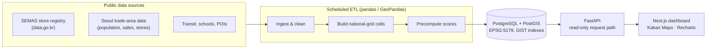

# Gilmok (길목) — Location Intelligence for Small-Business Founders

> **"Where should I open my café?"** Gilmok answers this with public data, not gut feeling.
> It finds locations where **demand is favorable relative to supply**, rather than simply
> places with fewer competitors, and shows where every number came from.

-orange)


---

## The problem

In Korea, many small businesses close within a few years, and site selection is one of the few
decisions a founder makes before opening and cannot easily undo. Professional location analysis
needs GIS skills, statistics and commercial real-estate knowledge that most first-time founders
don't have. Korea publishes rich public data (store registries, trade-area population, estimated
sales), but it is spread across portals, published at different geographic resolutions, and
hard to interpret.

## What Gilmok does

A founder picks a business category (e.g. café), searches a neighborhood, and clicks a point on
the map. Gilmok then shows:

- **Competition:** same-category stores within 300 m / 500 m / 1 km, density, distance to the
  nearest competitor and spatial clustering.
- **Demand:** residential, working and floating population, plus nearby offices, schools,
  universities and transit.
- **Explainable score:** a 0–100 composite of demand, competition, accessibility, growth and cost,
  with user-adjustable weights and the evidence behind each component.
- **Demand–supply heatmap and top-5 recommendations** for the selected area.
- **Side-by-side comparison** of 2–3 saved candidate sites, highlighting tradeoffs instead of
  declaring a winner.

Initial scope: **Mapo-gu, Seoul · cafés.** The design supports more districts and categories
through data and configuration, without restructuring code.

## Design principles

These are the decisions that make the project more than a map with pins.

1. **Demand relative to supply, not competitor count.** A dense café cluster often signals strong
   demand. The competition component is *estimated sales per same-category store*, and raw store
   count is never penalized. No input variable is counted in both demand and competition.
2. **Honest about missing data.** A missing component is never filled with an average or perfect
   score. The total is a weighted average over the components that have data, and **coverage**
   (the share of total weight that is available) is reported alongside it. Below 70% coverage
   the location shows as gray "insufficient data", with the reason.

   $$S = \frac{\sum_{k \in A} w_k S_k}{\sum_{k \in A} w_k}, \qquad \text{coverage} = \sum_{k \in A} w_k$$

3. **Resolution-aware.** Most demand data is published per trade-area polygon, not per building.
   Gilmok never presents trade-area values as building-level observations. Every indicator
   carries a resolution badge, its source and its reporting period.
4. **Comparable scores.** Each component is a percentile against all Seoul trade areas, so a
   score in Mapo-gu means the same as one in Gangnam-gu.
5. **Traceable provenance.** Every data row references a dataset version (source, license
   status, period, checksum). Every API response returns `sources` and `confidence`.
6. **Not a success predictor.** The score is a relative composite of indicators, never a
   probability of business success, and it is never labeled as one.
7. **No fabricated data.** Without API keys the app runs in a demo mode with synthetic data,
   which is flagged at the database level and always shows a "sample data" badge.

## Architecture



- **The request path only reads.** Pipelines ingest, clean and precompute grid scores, and API
  handlers read from the database. Heatmaps are never computed per request.
- **Metric storage, WGS84 at the edge.** Geometry is stored in EPSG:5179 (Korea's metric CRS)
  so `ST_DWithin` works in meters, and is converted to lat/lng only in API responses.
- **National-grid alignment.** Analysis cells (250 m by default, 100 m optional) snap to Korea's
  national standard grid, so population data published on that grid joins without
  interpolation.
- **Typed end to end.** Frontend TypeScript types are generated from the FastAPI OpenAPI spec.

More detail: [architecture](docs/architecture.md) · [scoring](docs/scoring.md) ·
[datasets](docs/datasets.md) · [pipelines](pipelines/README.md)

## Tech stack

| Layer | Tools |
|---|---|
| Frontend | Next.js (App Router), TypeScript, Tailwind CSS, shadcn/ui, Kakao Maps JS SDK, Recharts |
| Backend | Python, FastAPI, Pydantic v2, SQLAlchemy 2, GeoAlchemy2, Alembic |
| Spatial | PostgreSQL 16 + PostGIS 3.4, pyproj, Shapely, GeoPandas |
| Quality | pytest, Ruff, ESLint, `tsc --noEmit` |
| Infra | Docker Compose (local PostGIS), container-ready API (`Dockerfile`) |

## Progress

The project is built in seven reviewed steps.

| Step | Scope | Status |
|---|---|---|
| 1 | Architecture, PostGIS schema (14 tables, migrations), API contract, validation, tests | ✅ Done |
| 2 | Verify datasets: access, fields, update cycles, licenses | ⏳ Next |
| 3 | Responsive dashboard and interactive map (demo data, labeled) | Planned |
| 4 | Real SEMAS store ingestion and nearby-competitor analysis | Planned |
| 5 | Demand analysis and explainable scoring engine (tests first) | Planned |
| 6 | Precomputed heatmap, top-5 recommendations, comparison | Planned |
| 7 | Rule-based explanations, documentation, deployment | Planned |

**Implemented so far (Step 1):**

- Spatial schema with dataset provenance on every data table, synthetic-data flags,
  long-format trade-area metrics, versioned score configs and precomputed grid scores
- Alembic migrations, verified in both directions against a real PostGIS database
- API contract for 9 endpoints, with one error format (`{code, message, details}`), validated
  radius / bounding-box (max area) / weight parameters, and anonymous session keys
- 54 passing tests. They cover CRS transforms (EPSG:5179 false origin, sub-millimeter round
  trips), projected vs. ellipsoidal geodesic distance (agreement within 0.1% in Seoul), grid
  snapping, parameter validation and the HTTP error contract

## Getting started

Requirements: Docker, Python 3.12+ with [uv](https://docs.astral.sh/uv/), Node 20+.

```bash
cp .env.example .env
docker compose up -d db
```

API:

```bash
cd services/api
uv venv && uv pip install -e ".[dev]"
.venv/bin/alembic upgrade head
.venv/bin/pytest
.venv/bin/uvicorn app.main:app --reload --port 8000   # docs at http://localhost:8000/docs
```

Web:

```bash
cd apps/web
npm install
npm run gen:api   # regenerate API types from the running backend
npm run dev       # http://localhost:3000
```

### Credentials

All keys come from environment variables. Only `NEXT_PUBLIC_*` values reach the browser.

| Variable | Source | Notes |
|---|---|---|
| `DATA_GO_KR_SERVICE_KEY` | [data.go.kr](https://www.data.go.kr), dataset 15012005 | Server only |
| `SEOUL_OPEN_API_KEY` | [data.seoul.go.kr](https://data.seoul.go.kr) | Server only |
| `KAKAO_REST_API_KEY` | [Kakao Developers](https://developers.kakao.com) | Server only (search proxy) |
| `NEXT_PUBLIC_KAKAO_JS_KEY` | Kakao Developers | Browser; register each site domain under Platform → Web |

Without keys, the app runs in demo mode with clearly labeled synthetic data.

## Repository layout

```
apps/web/          Next.js dashboard
services/api/      FastAPI app: core/ (geo, validation, errors), models/, schemas/, routers/
pipelines/         Scheduled ETL jobs
data/              raw/ (git-ignored), demo/ (synthetic, labeled)
docs/              Architecture, scoring methodology, dataset registry
```

## Roadmap (beyond the MVP)

Reverse search ("what business fits this spot?"), more districts and categories, historical
trends, break-even simulation, review sentiment, survival analysis, PDF reports and a B2B API.

## Data and licensing

Gilmok uses Korean public datasets (SEMAS, Seoul Open Data Plaza, Seoul Trade Area Analysis
Service) and the Kakao Maps / Local APIs. Kakao API results are never stored. License,
redistribution and commercial-use terms for each dataset are tracked in
[docs/datasets.md](docs/datasets.md). Items not yet confirmed are marked *needs verification*.
